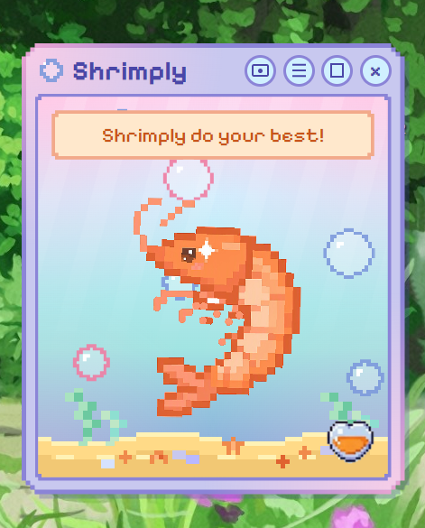
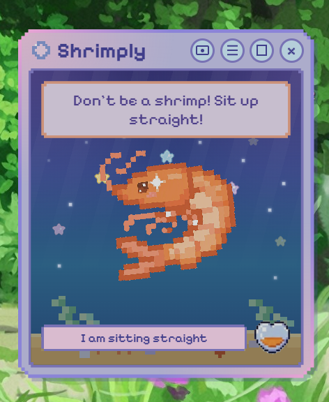
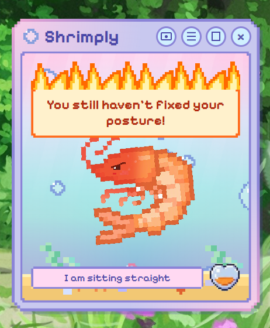
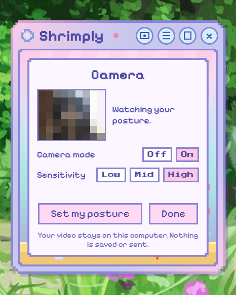
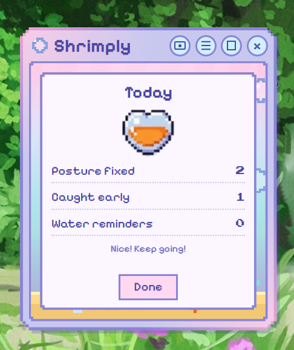

<p align="center">
  
</p>

<h1 align="center">Shrimply 🦐</h1>

<p align="center"><b>A tiny pixel shrimp that keeps an eye on your posture.</b></p>

<p align="center">
  <a href="https://github.com/dialeelova/shrimply/releases/latest/download/Shrimply-Setup.exe"><b>⬇ Download for Windows</b></a>
  &nbsp;·&nbsp;
  <a href="https://github.com/dialeelova/shrimply/releases/latest">All releases</a>
</p>

Shrimply is a small desktop companion for Windows. It lives on your screen, reminds you to sit up straight, and gets visibly unhappy when you ignore it. It can work with a simple timer or, optionally, with your webcam, noticing on its own when you start to slouch.

<table align="center">
  <tr>
    <td align="center"><br><sub>A gentle reminder</sub></td>
    <td align="center"><br><sub>When it is ignored</sub></td>
  </tr>
  <tr>
    <td align="center"><br><sub>Camera Mode</sub></td>
    <td align="center"><br><sub>Daily stats</sub></td>
  </tr>
</table>

## The Idea Behind the Project

Long hours at a computer are part of everyday life for IT students and for millions of people who work or study on a screen. Over time, most of us begin to lean toward the monitor without noticing: the head moves forward, the shoulders round, and the whole posture slowly curls up, much like a shrimp. The result is neck and back pain, fatigue, and a habit that is hard to break, because the slouching happens gradually and usually goes unnoticed until it already hurts.

Shrimply was created for people who face this problem in their daily life. Instead of a strict alarm, it offers something friendlier: a small pixel shrimp that lives on your screen, gently reminds you to sit up straight, and shows how unhappy it is if the reminders are ignored.

<p align="center">
  
</p>

## Features

- **Posture reminders.** After 20 minutes (adjustable: 15, 20, 30 or 45) the shrimp starts to curl, and two minutes later it is fully curled. A soft chime plays, and one click confirms you have straightened up.
- **Camera Mode (optional).** The shrimp watches your head and shoulders through the webcam and reminds you as soon as you start to bend. When you sit up again, it notices by itself.
- **An angry shrimp.** If your posture is not fixed within three minutes of the first reminder, the shrimp turns angry: a burning message box appears and a warning sound plays.
- **Water reminders.** Once an hour, with a soft water-drop sound and falling pixel drops.
- **Daily stats.** A heart that fills up as you fix your posture, with a count of the day's reminders.
- **Night mode.** The shrimp falls asleep, and there are no reminders or sounds until you turn it off.
- **Stays out of the way.** Small, always on top, draggable, able to shrink to 70%, and happy to live in the system tray.

## Download and Install

1. [Download **Shrimply-Setup.exe**](https://github.com/dialeelova/shrimply/releases/latest/download/Shrimply-Setup.exe).
2. Run it. It installs automatically (no administrator rights needed), adds a shortcut to your desktop and Start menu, and opens Shrimply.
3. Windows may show a blue **"Windows protected your PC"** screen. This appears for any app that is not signed with a paid certificate. Click **More info**, then **Run anyway**.

Requires Windows 10 or 11 (64-bit). Closing the window hides Shrimply in the system tray; right-click the tray icon to quit. To uninstall, use *Settings → Apps*.

## Using Camera Mode

1. Click the camera button in the title bar, turn **Camera mode** on, and allow camera access if Windows asks.
2. Sit up straight and press **Set my posture**. Hold still for a few seconds.
3. That's it. If your head sinks toward your shoulders or you lean toward the screen for about 10 seconds, the shrimp speaks up.

**Sensitivity** sets how much you can bend before it reacts. Choose *Low* if it reminds you too often, or *High* if it misses real slouching. Make sure your head and shoulders are visible to the camera. Reminders pause when the camera cannot see you and while night mode is on.

## Privacy

- Pose detection runs entirely on your computer and works offline. The detection model is bundled inside the app.
- Video is never saved, recorded, or sent anywhere. Only a few numbers (the position of your head and shoulders) are used.
- A small pink dot next to the title shows whenever the camera is on, and Camera Mode can be turned off at any time.
- Settings and daily stats are stored only on your computer.

## Run from Source

Requires [Node.js](https://nodejs.org).

```bash
git clone https://github.com/dialeelova/shrimply.git
cd shrimply
npm install
npm start
```

Two extra commands are handy for trying things out: `npm run demo` brings reminders in seconds instead of minutes, and `npm run night` shows the sleeping shrimp.

## Built With

- [Electron](https://www.electronjs.org), HTML, CSS and JavaScript
- [MediaPipe Pose](https://developers.google.com/mediapipe) (Apache License 2.0) for offline pose detection
- Pixelify Sans and Press Start 2P fonts (SIL Open Font License)
- Pixel art by the author

## License

Released under the [MIT License](LICENSE). The bundled fonts and MediaPipe keep their own licenses.
