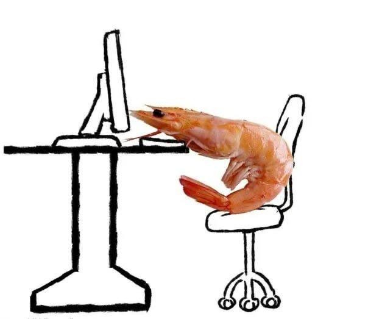

# Shrimply 🦐

**A tiny pixel shrimp that keeps an eye on your posture.**

[**⬇ Download for Windows**](https://github.com/dialeelova/shrimply/releases/latest/download/Shrimply-Setup.exe)  ·  [All releases](https://github.com/dialeelova/shrimply/releases/latest)

Shrimply is a small desktop companion for Windows. It lives on your screen, reminds you to sit up straight, and gets visibly unhappy when you ignore it. Use a simple timer, or turn on your webcam and let it notice slouching on its own.

## Why Shrimply?

Long hours at a screen make us lean in: head forward, shoulders rounded, curled up like a shrimp. It happens slowly, so we rarely notice until it hurts. Instead of a strict alarm, Shrimply gives you a friendly pixel shrimp that gently nudges you to sit up straight.

<p align="center">
  
</p>

## Features

- **Posture reminders:** after 20 minutes (or 15, 30, 45) the shrimp starts to curl. A soft chime plays, and one click confirms you sat up.
- **Camera Mode (optional):** the shrimp watches your head and shoulders and speaks up as soon as you bend.
- **Angry shrimp:** ignore it for three minutes and it turns angry, with a burning message box and a warning sound.
- **Water reminders:** a gentle nudge once an hour.
- **Daily stats:** a heart that fills up as you fix your posture.
- **Night mode:** the shrimp falls asleep, with no reminders or sounds.
- **Stays out of the way:** small, always on top, draggable, and happy in the system tray.

## Install

1. [Download **Shrimply-Setup.exe**](https://github.com/dialeelova/shrimply/releases/latest/download/Shrimply-Setup.exe) and run it. No administrator rights needed.
2. If Windows shows **"Windows protected your PC"**, click **More info**, then **Run anyway**. This appears for any app without a paid certificate.

Requires Windows 10 or 11 (64-bit). Closing the window hides Shrimply in the tray; right-click the tray icon to quit.

## Camera Mode

1. Click the camera button in the title bar, turn **Camera mode** on, and allow camera access.
2. Sit up straight and press **Set my posture**. Hold still for a few seconds.
3. Done. If you slouch for about 10 seconds, the shrimp speaks up.

Too many reminders? Lower **Sensitivity**. Missing real slouching? Raise it.

## Privacy

- Pose detection runs fully offline on your computer.
- Video is never saved or sent anywhere.
- A pink dot shows whenever the camera is on.
- Settings and stats stay on your computer.

## Run from Source

Requires [Node.js](https://nodejs.org).

```
git clone https://github.com/dialeelova/shrimply.git
cd shrimply
npm install
npm start
```

Now sit up straight! ✨
